# Unidad 2 - Diseño lógico de base de datos <!-- omit from toc -->

**Módulo:** Gestión de base de datos

**RA2:** Diseña modelos lógicos normalizados interpretando diagramas entidad/relación.

---

## 1. Modelo de datos

*(CE-a: Se ha identificado el significado de la simbología propia de los diagramas entidad/relación)*

Un **modelo de datos** es un conjunto de herramientas conceptuales para describir los datos, sus relaciones, su semántica y las restricciones de consistencia. Permite pasar de un problema del mundo real a una base de datos implementada.

El diseño de una base de datos se hace en tres niveles de abstracción:

| Nivel | Modelo | Qué describe | Ejemplo |
|---|---|---|---|
| **Conceptual** | Entidad/Relación | Qué datos hay y cómo se relacionan, independiente del SGBD | Diagrama E/R |
| **Lógico** | Relacional | Estructura en tablas, campos, claves; depende del tipo de SGBD, no del producto | Esquema relacional |
| **Físico** | Específico del SGBD | Tipos de datos, índices, almacenamiento | Script SQL de MySQL/PostgreSQL |


Esta unidad se centra en el paso **conceptual → lógico**.

---

## 2. El modelo Entidad/Relación (E/R)

Propuesto por Peter Chen (1976). Representa la realidad mediante **entidades**, **atributos** y **relaciones**, usando un diagrama.

### 2.1 Simbología del diagrama E/R

Existen varias notaciones. La clásica de Chen usa:

| Elemento | Símbolo (Chen) | Significado |
|---|---|---|
| Entidad | Rectángulo | Objeto del mundo real distinguible (Alumno, Curso) |
| Entidad débil | Rectángulo doble | Entidad que depende de otra para identificarse |
| Relación | Rombo | Asociación entre entidades (Matricula) |
| Relación identificadora | Rombo doble | Relación que une una entidad débil con su fuerte |
| Atributo | Elipse | Propiedad de una entidad o relación |
| Atributo clave | Elipse con nombre subrayado | Identifica de forma única cada ocurrencia |
| Atributo multivalorado | Elipse doble | Puede tener varios valores |
| Atributo derivado | Elipse discontinua | Se calcula a partir de otros (edad) |
| Cardinalidad | Etiqueta (1, N, M) o (min,max) en la línea | Nº de ocurrencias que intervienen |
| Línea | Segmento | Une entidades con relaciones y atributos |
| Jerarquía (ISA) | Triángulo | Generalización/especialización |

En algunos materiales se usa también una **variante compacta inspirada en Chen**: los atributos se escriben fuera del rectángulo de la entidad y se conectan a este, pero se omiten las elipses de Chen clásico. En la variante del ejemplo de abajo, un círculo precede a cada atributo:

- `●` **atributo obligatorio**: debe tener un valor.
- `○` **atributo opcional**: puede no tener valor.

Estos círculos indican obligatoriedad, **no si el atributo es clave**. Para mostrar las claves en este ejemplo, se subrayan sus nombres, como en Chen clásico. La convención de los círculos puede variar entre materiales y herramientas, por lo que conviene incluir una leyenda que explique los símbolos.

En la notación **pata de gallo** (crow's foot), muy usada en herramientas, las relaciones son líneas y la cardinalidad se dibuja en los extremos:

| Símbolo | Significado |
|---|---|
| `\|\|` | Uno y solo uno (1,1) |
| `o\|` | Cero o uno (0,1) |
| `\|{` | Uno o muchos (1,N) |
| `o{` | Cero o muchos (0,N) |

### 2.2 Entidades y atributos

- **Entidad:** objeto o concepto sobre el que se guarda información. Se nombra en singular y se distingue entre **tipo de entidad** (ALUMNO) y **ocurrencia** o instancia (el alumno Pedro).
- **Atributo:** propiedad que describe a la entidad. Tipos:
    - **Simple / compuesto:** `nombre` es simple; `domicilio` es compuesto si se desglosa en `calle`, `localidad` y `código_postal`.
    - **Monovalorado / multivalorado:** `fecha_nacimiento` tiene un valor por persona; `teléfono` puede tener varios.
    - **Obligatorio / opcional:** `nombre` es obligatorio; `segundo_apellido` puede ser opcional si no todas las personas lo tienen.
    - **Derivado:** `edad` puede calcularse a partir de `fecha_nacimiento`.
- **Identificador (clave candidata):** atributo o conjunto de atributos que identifica de forma única cada ocurrencia. El elegido es el **identificador principal**.

Ejemplo de atributos de `PERSONA` con simbología de Chen:

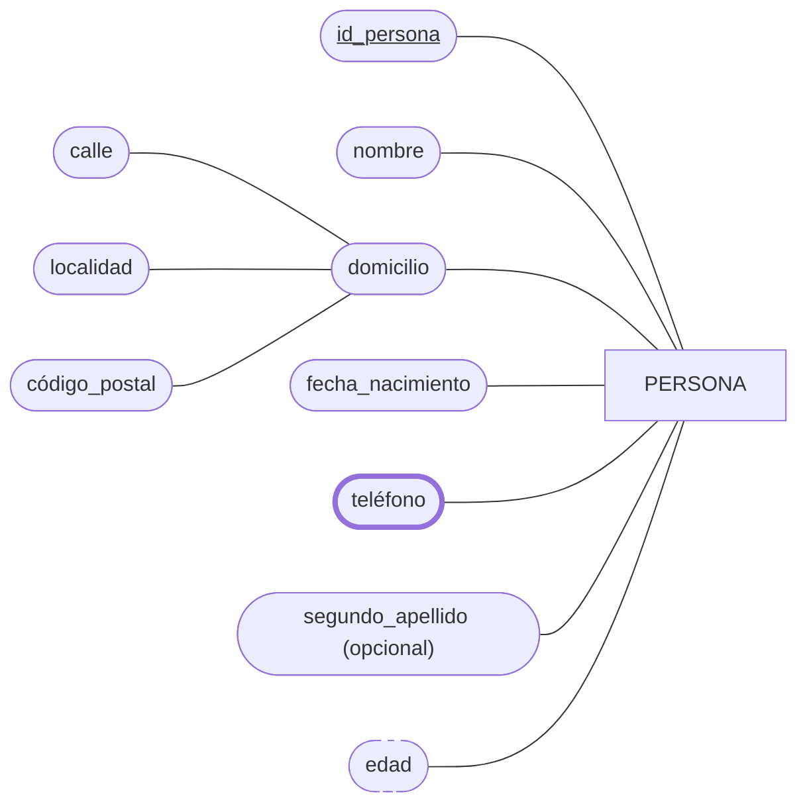

- `PERSONA` es la **entidad** (rectángulo); cada atributo se conecta a ella con una línea. `id_persona` está subrayado porque es el identificador.
- `nombre` es un atributo **simple** y **monovalorado**; se considera **obligatorio** en este ejemplo. `fecha_nacimiento` también es monovalorado.
- `domicilio` es **compuesto**: se desglosa en `calle`, `localidad` y `código_postal`, que se conectan al atributo compuesto.
- `teléfono` es **multivalorado**: una persona puede tener varios teléfonos. En Chen se representa con una **elipse doble**; Mermaid no dispone de una forma de doble elipse, por lo que aquí se indica con un borde más grueso.
- `segundo_apellido` es **opcional** en este ejemplo. En la notación básica de Chen, la opcionalidad no tiene una forma propia de atributo, así que se aclara en la etiqueta.
- `edad` es **derivado** de `fecha_nacimiento`; en Chen se representa con una elipse discontinua, indicada aquí con el borde discontinuo.

### 2.3 Relaciones

Una **relación** asocia dos o más entidades. Se nombra con un verbo (Imparte, Matricula).

- **Grado:** número de entidades que participan: 
    
    - **Unaria/reflexiva** (1): un `EMPLEADO` supervisa a otro `EMPLEADO`. Como participa la misma entidad en dos papeles, se indican los roles **supervisor** y **subordinado**.
    - **Binaria** (2): un `ALUMNO` cursa una `ASIGNATURA`.
    - **Ternaria** (3): un `PROVEEDOR` suministra un `PRODUCTO` a un `PROYECTO`.
    - …
- Una relación puede tener **atributos propios**, que describen la asociación y no una entidad. Por ejemplo, `calificación` depende de la matrícula concreta de un alumno en una asignatura.
- **Rol:** función que desempeña una entidad en una relación; es imprescindible en las relaciones reflexivas, donde la misma entidad participa con papeles distintos.

Ejemplo de relación **unaria/reflexiva** en notación de Chen:

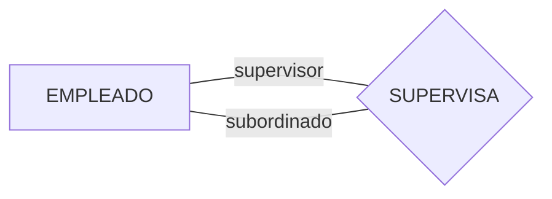

Las dos líneas conectan la misma entidad con la relación, pero con roles diferentes: quien supervisa es el **supervisor** y quien recibe la supervisión es el **subordinado**.

Ejemplo de relación **binaria** con un atributo propio en notación de Chen:

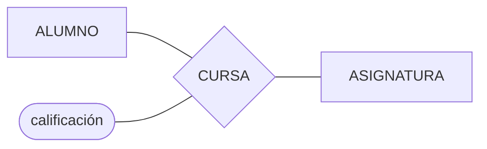

`CURSA` es binaria porque relaciona dos entidades (`ALUMNO` y `ASIGNATURA`). `calificación` se conecta al rombo porque es un atributo de la relación: registra la nota obtenida por ese alumno en esa asignatura.

Ejemplo de relación **ternaria** en notación de Chen:

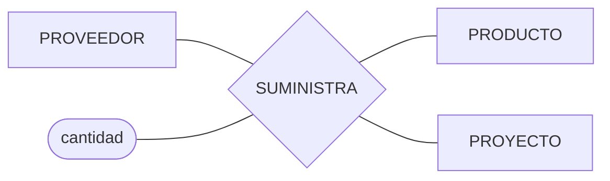

`SUMINISTRA` es ternaria porque asocia simultáneamente tres entidades. Cada ocurrencia indica qué proveedor suministra qué producto y a qué proyecto. `cantidad` es un atributo propio de esa combinación: el mismo proveedor puede enviar distintas cantidades de un producto a proyectos diferentes. El rombo único conectado a las tres entidades representa la relación ternaria; no debe sustituirse por tres relaciones binarias si se necesita conservar el significado conjunto.

### 2.4 Cardinalidad

Indica **cuántas ocurrencias** de una entidad se asocian con una de la otra.

**Cardinalidad máxima** (tipo de correspondencia):

| Tipo | Significado | Ejemplo |
|---|---|---|
| **1:1** | Una ocurrencia de A con una de B | EMPLEADO – PLAZA_PARKING |
| **1:N** | Una de A con muchas de B | DEPARTAMENTO – EMPLEADO |
| **N:M** | Muchas de A con muchas de B | ALUMNO – MÓDULOS |

**Cardinalidad mínima / participación:** 

- **0** (opcional, participación parcial) 
- **1** (obligatoria, participación total). 

Se expresa como par **(mín, máx)**: (0,1), (1,1), (0,N), (1,N).

> Atención: en la notación (mín,máx) de Chen/Merise, cada par se coloca junto a la entidad **a la que se refiere**; en la notación de tipo 1:N, la N queda del lado "muchos".

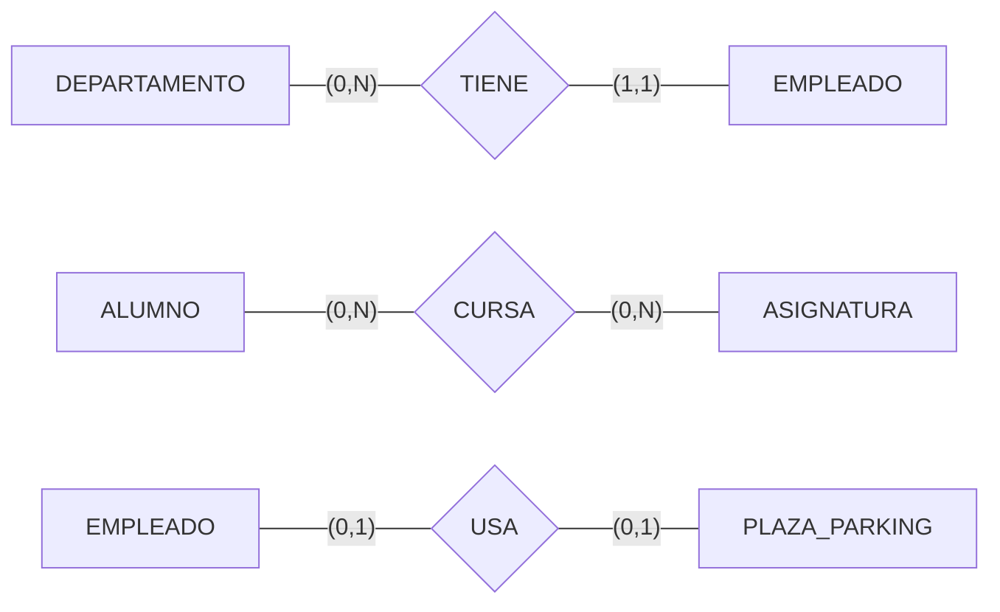

### 2.5 Entidades débiles

Una **entidad débil** no tiene atributos suficientes para identificarse por sí misma: su existencia y su identificación **dependen de otra entidad fuerte** (propietaria).

- **Dependencia en existencia:** si se borra la fuerte, desaparecen las débiles.
- **Dependencia en identificación:** la clave de la débil = clave de la fuerte + un **discriminador** (atributo parcial que distingue entre las débiles de una misma fuerte).
- Se une con una relación identificadora 1:N, con participación total de la débil.

Ejemplo: `EDIFICIO` (cod_edificio) y `AULA` (nº de aula). El aula "101" se repite en cada edificio, así que AULA se identifica con (cod_edificio, num_aula).

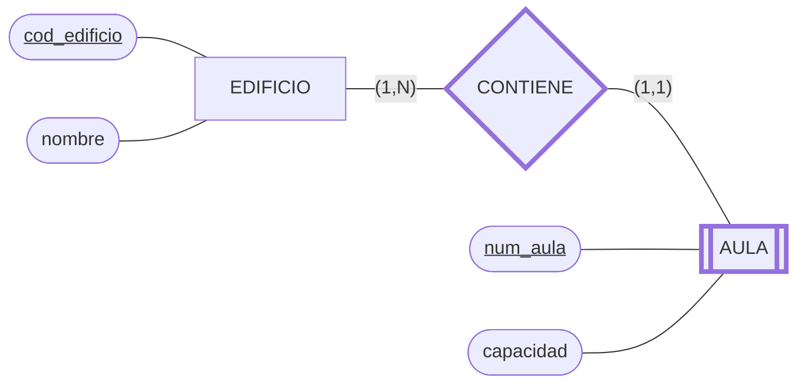

En Chen, `AULA` se representa con **rectángulo doble** porque es débil y `CONTIENE` con **rombo doble** porque es la relación identificadora. Mermaid no ofrece formas nativas de doble rectángulo ni de doble rombo; en el diagrama se indican mediante nodos de borde grueso (y la forma de subrutina para `AULA`) como aproximación visual. `num_aula` es el **discriminador** o clave parcial: se subraya para señalar que, junto con `cod_edificio`, identifica cada aula. Así, la clave completa de AULA es `(cod_edificio, num_aula)`.

### 2.6 Herramientas gráficas

*(CE-b: Se han utilizado herramientas gráficas para representar el diseño lógico)*

| Herramienta | Tipo | Notas |
|---|---|---|
| **MySQL Workbench** | Escritorio, gratuita | Diseño EER, genera SQL y hace ingeniería inversa |
| **draw.io (diagrams.net)** | Web/escritorio, gratuita | Diagramas genéricos, plantillas E/R |
| **dbdiagram.io** | Web | Diagramas a partir de código DBML |
| **Mermaid** | Texto → diagrama | Se integra en Markdown (los de estos apuntes) |
| **pgModeler / DBeaver** | Escritorio | Modelado y diagramas para PostgreSQL, ER automáticos |
| **Lucidchart, ER/Studio, Visual Paradigm** | Comerciales | Modelado profesional |

Buenas prácticas: nombres claros y coherentes, mostrar claves y cardinalidades, un solo diagrama legible por tema.

### 2.7 Ejemplo completo con notación de Chen

**Contexto:** un centro de formación quiere registrar qué módulos cursa cada alumno en cada curso académico y la calificación final que obtiene. Todo alumno matriculado cursa al menos un módulo y cada módulo ofertado tiene al menos un alumno; ambos pueden estar asociados a varios. Para evitar confundir matrículas de cursos académicos distintos, cada matrícula queda identificada por el alumno, el módulo y el curso académico.

**Definición del modelo:** `ALUMNO` y `MÓDULO` son entidades porque representan objetos sobre los que el centro guarda información. `SE MATRICULA` es una relación muchos a muchos (N:M) que expresa que un alumno cursa un módulo. `curso_académico` y `calificación` son atributos de esa relación: describen cada matrícula, no al alumno ni al módulo por separado. Las claves subrayadas identifican de forma única cada entidad; para la matrícula, la combinación de las claves de ambas entidades y el curso académico identifica cada ocurrencia.

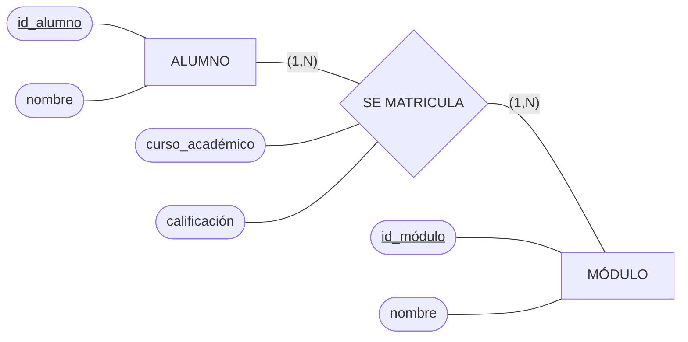

**Cómo leerlo:**

- Los **rectángulos** son entidades, el **rombo** es la relación y las **elipses** son atributos, siguiendo la simbología clásica de Chen. Las claves de las entidades aparecen subrayadas; también se subraya `curso_académico` porque completa la identificación de cada matrícula.
- `(1,N)` junto a `ALUMNO` indica que todo alumno participa en la relación al menos una vez y puede cursar varios módulos. Junto a `MÓDULO` indica que todo módulo ofertado tiene al menos un alumno y puede tener varios. Cada ocurrencia de la relación corresponde a un único alumno y a un único módulo.
- `curso_académico` forma parte de la identificación de una matrícula: un mismo alumno puede volver a cursar el mismo módulo en otro curso. Por tanto, la clave de `SE MATRICULA` es `(id_alumno, id_módulo, curso_académico)`.
- `calificación` pertenece a la relación porque depende de la matrícula concreta. Así, el alumno puede obtener calificaciones diferentes en distintos módulos o cursos.

#### Variante compacta: atributos fuera de las entidades

El siguiente diagrama representa **el mismo ejemplo ALUMNO–MÓDULO** de esta sección, ahora con la variante compacta. Los atributos no se representan con  una elipse por cada uno. `curso_académico` y `calificación` se conectan al rombo `SE MATRICULA` porque describen cada matrícula concreta.

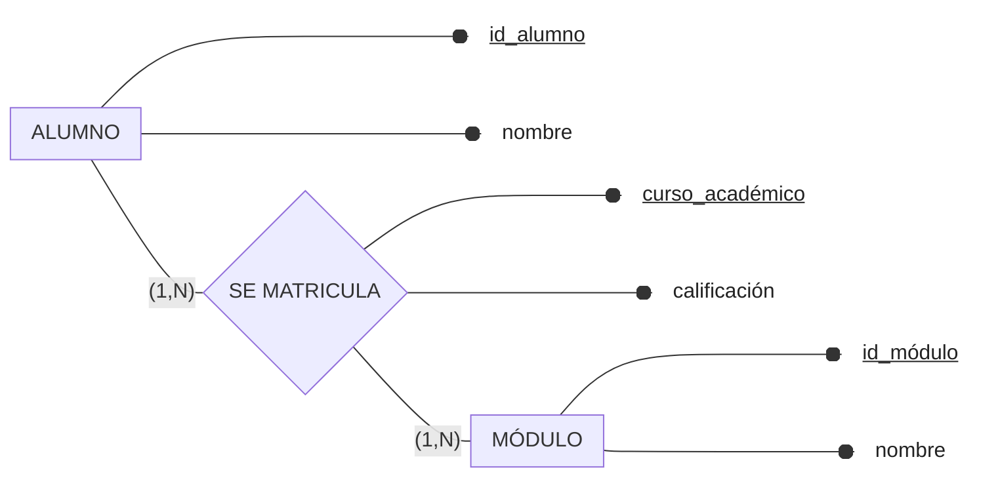

En este modelo todos los atributos se consideran obligatorios, por eso aparecen con `●`; si, por ejemplo, la calificación pudiera no estar registrada todavía, se marcaría con `○`. Los atributos subrayados son identificadores. La clave de cada matrícula se forma con `id_alumno`, `id_módulo` y `curso_académico`. Los pares `(mín,máx)` y las relaciones son los mismos que en el diagrama clásico.
 
---

## 3. El modelo E/R ampliado

El **modelo E/R extendido (EER)** añade conceptos para modelar situaciones más complejas, sobre todo **jerarquías**:

- **Generalización:** varias entidades con características comunes se agrupan en una **superentidad** (EMPLEADO y CLIENTE → PERSONA).
- **Especialización:** una entidad se divide en **subentidades** con atributos propios (VEHICULO → COCHE, MOTO). Las subentidades **heredan** los atributos y relaciones de la superentidad.

Restricciones de la jerarquía:

| Restricción | Opciones |
|---|---|
| **Solapamiento** | **Disjunta (d):** un ejemplar pertenece a una sola subentidad. **Solapada (o):** puede pertenecer a varias |
| **Cobertura** | **Total:** todo ejemplar de la superentidad está en alguna subentidad. **Parcial:** puede no estar en ninguna |

Otros conceptos del modelo ampliado: **agregación** (una relación se trata como entidad para relacionarla con otra), **atributos compuestos**, **relaciones ternarias** y **restricciones de participación**.

Ejemplo: una empresa registra personas como empleados o clientes. En este caso, la especialización es **disjunta** (`d`) y **total**: cada persona pertenece exactamente a uno de los dos subtipos.

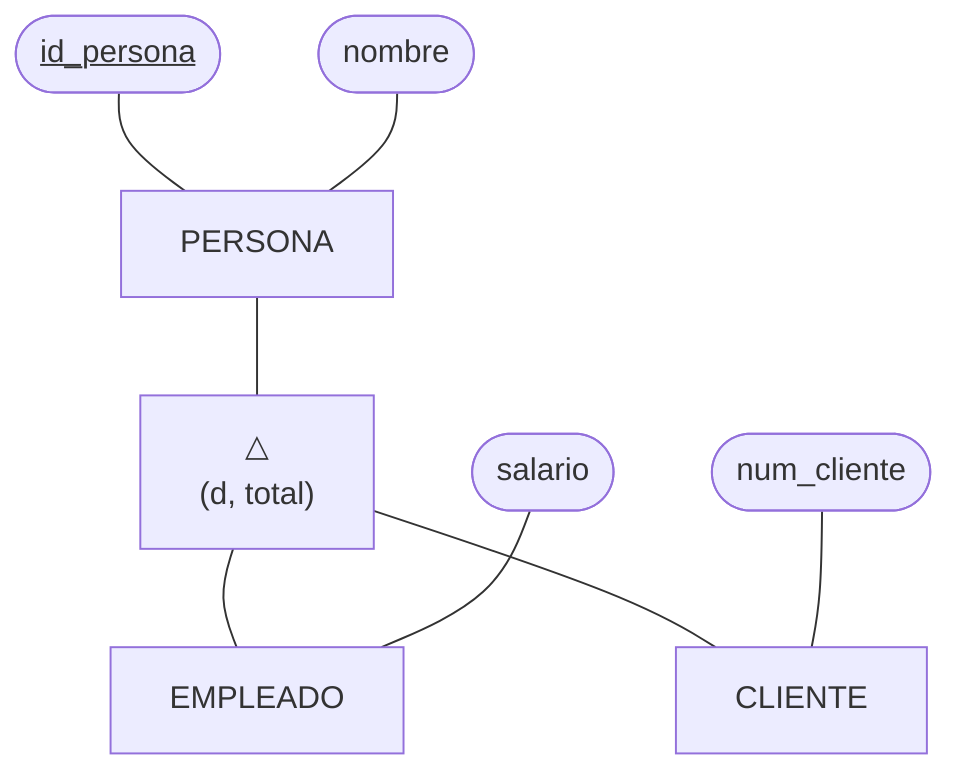

El rectángulo `PERSONA` es la superentidad; el triángulo `△` representa la especialización ISA. La anotación `(d, total)` indica que los subtipos son disjuntos y que toda persona pertenece a uno de ellos. Las líneas conectan la superentidad con `EMPLEADO` y `CLIENTE`, que heredan `id_persona` y `nombre`; cada subtipo añade su atributo específico.

---

## 4. El modelo relacional

Propuesto por E. F. Codd (1970), basado en la teoría de conjuntos y la lógica de predicados. Es el modelo lógico más extendido. Los datos se organizan en **relaciones** (tablas).

### 4.1 Terminología

*(CE-c: Se han identificado las tablas del diseño lógico; CE-d: Se han identificado los campos que forman parte de las tablas)*

| Término formal | Término habitual (SQL) | Descripción |
|---|---|---|
| **Relación** | Tabla | Conjunto de filas con la misma estructura |
| **Tupla** | Fila / registro | Una ocurrencia de la entidad |
| **Atributo** | Columna / campo | Propiedad con un nombre |
| **Dominio** | Tipo de dato + restricciones | Conjunto de valores válidos de un atributo |
| **Grado** | Nº de columnas | Número de atributos |
| **Cardinalidad** | Nº de filas | Número de tuplas |
| **Esquema** | Cabecera | `ALUMNO(dni, nombre, fecha_nac)` |

Notación de esquema: `ALUMNO(`<u>dni</u>`, nombre, fecha_nac)` — la clave primaria se subraya y las claves ajenas se marcan con `#` o en cursiva.

Ejemplo de tabla:

| <u>dni</u> | nombre | fecha_nac |
|---|---|---|
| 11111111A | Ana | 2005-03-02 |
| 22222222B | Luis | 2004-11-20 |

### 4.2 Características de una relación (tabla)

- Cada tabla tiene un **nombre único** en el esquema.
- Cada columna tiene un **nombre único** dentro de la tabla.
- Los valores de cada atributo son **atómicos** (un solo valor, no listas) y del mismo dominio.
- **No hay tuplas duplicadas.**
- **El orden de filas y columnas no es significativo.**
- Debe existir una **clave primaria** que identifique cada fila.

### 4.3 Claves

*(CE-f: Se han definido los campos clave)*

| Clave | Definición |
|---|---|
| **Superclave** | Conjunto de atributos que identifica unívocamente una tupla |
| **Clave candidata** | Superclave **mínima** (si quitas un atributo deja de identificar) |
| **Clave primaria (PK)** | Clave candidata elegida; no admite nulos ni repetidos |
| **Clave alternativa** | Candidata no elegida como primaria (se declara `UNIQUE`) |
| **Clave ajena / foránea (FK)** | Atributo(s) cuyos valores deben existir como clave primaria (o candidata) de otra tabla (o la misma) |
| **Clave compuesta** | Clave formada por varios atributos |
| **Clave subrogada (surrogate)** | Identificador artificial (autonumérico) sin significado real |

Ejemplo: en `ALUMNO(dni, nº_expediente, email, nombre)`, `dni`, `nº_expediente` y `email` son candidatas; se elige `dni` como PK y las otras son alternativas.

> Criterios para elegir la PK: estable (no cambia), no nula, corta y sencilla, única siempre.

### 4.4 Reglas de integridad

*(CE-g: Se han aplicado las reglas de integridad)*

1. **Integridad de entidad:** ningún atributo de la clave primaria puede ser nulo.
2. **Integridad referencial:** una clave ajena debe ser **nula** (si se permite) o coincidir con un valor existente de la clave referenciada.
3. **Integridad de dominio:** cada valor debe pertenecer al dominio del atributo (tipo, rango, `CHECK`).
4. **Unicidad y obligatoriedad:** `UNIQUE`, `NOT NULL`.
5. **Integridad definida por el usuario (reglas de negocio):** `CHECK`, disparadores…

**Acciones referenciales** al borrar o modificar la fila referenciada:

| Opción | Efecto |
|---|---|
| `RESTRICT` / `NO ACTION` | Impide la operación si hay filas dependientes |
| `CASCADE` | Propaga el borrado/modificación a las filas dependientes |
| `SET NULL` | Pone la clave ajena a NULL |
| `SET DEFAULT` | Pone el valor por defecto |

```sql
CREATE TABLE empleado (
    dni        CHAR(9) PRIMARY KEY,
    nombre     VARCHAR(50) NOT NULL,
    salario    DECIMAL(8,2) CHECK (salario > 0),
    cod_dep    INT,
    FOREIGN KEY (cod_dep) REFERENCES departamento(cod_dep)
        ON DELETE SET NULL ON UPDATE CASCADE
);
```

---

## 5. Paso del diagrama E/R al modelo relacional

*(CE-e: Se han identificado las relaciones entre las tablas del diseño lógico)*

### 5.1 Reglas de transformación

| Elemento del E/R | Resultado en el modelo relacional |
|---|---|
| **Entidad** | Una **tabla**; sus atributos son columnas; el identificador pasa a ser **PK** |
| **Atributo compuesto** | Se divide en sus componentes (una columna por cada uno) |
| **Atributo derivado** | Normalmente no se almacena (se calcula) |
| **Atributo multivalorado** | Nueva tabla con PK = (PK de la entidad + atributo), FK a la entidad |
| **Relación 1:1** | La PK de una tabla se añade como **FK (UNIQUE)** en la otra. Se coloca en la de participación total u obligatoria. Si ambas son totales, se pueden fundir en una sola tabla |
| **Relación 1:N** | La PK del lado "1" se añade como **FK** en la tabla del lado "N" |
| **Relación N:M** | Nueva **tabla intermedia** con las PK de ambas como FK; su PK es la combinación de ambas (+ atributos de la relación) |
| **Relación ternaria N:M:P** | Tabla con las tres claves ajenas; PK compuesta adecuada según cardinalidades |
| **Relación reflexiva** | 1:N: FK a la propia tabla. N:M: tabla intermedia con dos FK a la misma tabla |
| **Entidad débil** | Tabla con PK = (PK de la fuerte + discriminador); la PK de la fuerte es FK (`ON DELETE CASCADE`) |
| **Jerarquía (ISA)** | Tres opciones, ver abajo |

**Opciones para jerarquías:**

1. **Una tabla por la superentidad y otra por cada subentidad** (la PK de la sub es FK a la super). Es la más general y flexible.
2. **Solo tablas para las subentidades**, repitiendo los atributos comunes (válida para jerarquías disjuntas y totales).
3. **Una única tabla** con todos los atributos y un campo `tipo` (genera muchos nulos).

### 5.2 Ejemplo completo

Enunciado: un instituto tiene **departamentos** con varios **profesores**; los **alumnos** se matriculan en **modulos** y obtienen una **nota**; los módulos los imparte un profesor.

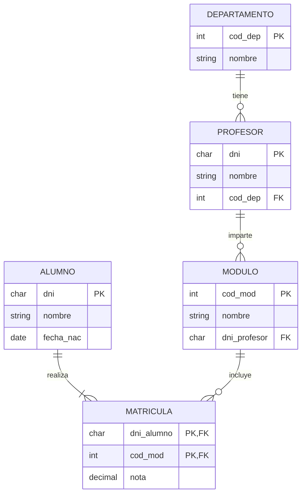

> **Lectura de símbolos y cardinalidades:** `||` significa **uno y solo uno**; `o{` significa **cero o muchos**; `|{` significa **uno o muchos**. El símbolo situado junto a cada entidad indica cuántas de sus ocurrencias pueden asociarse con una ocurrencia de la entidad opuesta. Por ejemplo, en `DEPARTAMENTO ||--o{ PROFESOR`, cada profesor pertenece a un único departamento, mientras que un departamento puede tener cero o muchos profesores. Del mismo modo, un profesor puede impartir cero o muchos módulos, y cada módulo lo imparte un único profesor; cada alumno debe tener una o muchas matrículas, y cada matrícula corresponde a un único alumno y un único módulo.

Esquema relacional resultante (PK subrayada con `_`, FK con `#`):

```
DEPARTAMENTO(_cod_dep_, nombre)
PROFESOR(_dni_, nombre, #cod_dep)
MODULO(_cod_mod_, nombre, #dni_profesor)
ALUMNO(_dni_, nombre, fecha_nac)
MATRICULA(_#dni_alumno_, _#cod_mod_, nota)
```

Procedimiento: 

1) una tabla por entidad 
2) 1:N → FK en el lado N
3) N:M → tabla `MATRICULA`
4) los atributos de la relación (`nota`) van a la tabla intermedia 
5) definir PK, FK y acciones referenciales.

### 5.3 Restricciones que no pueden plasmarse en el diseño lógico

*(CE-i: Se han identificado y documentado las restricciones que no pueden plasmarse en el diseño lógico)*

Algunas reglas del problema **no se pueden expresar** con tablas, claves y relaciones. Deben **documentarse** (en un apartado del diseño) para implementarlas después con `CHECK`, disparadores (*triggers*), procedimientos o en la aplicación.

Ejemplos:

- Un alumno no puede matricularse en más de 8 módulos por curso.
- La nota debe estar entre 0 y 10 y solo puede ponerse si la matrícula está abierta.
- Un profesor no puede impartir dos módulos a la misma hora.
- Una jerarquía **total/disjunta** (garantizar que cada persona sea exactamente de un subtipo).
- Un departamento debe tener al menos un profesor (cardinalidad mínima 1 en el lado "muchos").
- La fecha de fin debe ser posterior a la de inicio entre columnas de distintas tablas.
- Los atributos derivados (edad, total del pedido).

Formato recomendado de documentación:

| Nº | Restricción | Tablas implicadas | Cómo se implementará |
|---|---|---|---|
| R1 | Máx. 8 módulos por alumno y curso | MATRICULA | Trigger |
| R2 | Departamento con al menos un profesor | DEPARTAMENTO, PROFESOR | Aplicación / trigger |

---

## 6. Normalización

*(CE-h: Se han aplicado las reglas de normalización hasta un nivel adecuado)*

La **normalización** es el proceso de organizar las tablas para **eliminar redundancia** y evitar **anomalías** de inserción, borrado y modificación, mediante la descomposición en tablas más pequeñas **sin pérdida de información**. Se basa en las **dependencias funcionales**.

Ejemplo de tabla mal diseñada:

| id_pedido | cod_cli | nombre_cli | ciudad_cli | cod_prod | desc_prod | cant |
|---|---|---|---|---|---|---|
| 1 | C1 | Ana | Madrid | P1 | Ratón | 2 |
| 1 | C1 | Ana | Madrid | P2 | Teclado | 1 |

Anomalías: si Ana cambia de ciudad hay que actualizarlo en varias filas (**modificación**); no se puede guardar un producto sin pedido (**inserción**); borrar el único pedido de un cliente elimina al cliente (**borrado**).

### 6.1 Dependencias funcionales

- **Dependencia funcional (DF):** `A → B` si cada valor de A determina un único valor de B. (`dni → nombre`).
- **DF completa:** B depende de toda la clave compuesta, no de una parte.
- **DF parcial:** B depende solo de una parte de la clave compuesta.
- **DF transitiva:** `A → B` y `B → C` (con B no clave) entonces `A → C` de forma transitiva.

### 6.2 Primera forma normal (1FN)

Una tabla está en **1FN** si todos sus atributos son **atómicos** (sin grupos repetitivos ni multivalorados) y tiene clave primaria.

| Antes (no 1FN) | Después (1FN) |
|---|---|
| ALUMNO(dni, nombre, **teléfonos**="600,700") | ALUMNO(dni, nombre) + TELEFONO(dni, teléfono) |

### 6.3 Segunda forma normal (2FN)

Está en **2FN** si está en 1FN y **todo atributo no clave depende de la clave completa** (sin dependencias parciales). Solo es relevante con claves compuestas.

Ejemplo: `LINEA(id_pedido, cod_prod, desc_prod, cant)`, clave (id_pedido, cod_prod). `cod_prod → desc_prod` es parcial.

Descomposición:
```
LINEA(_id_pedido_, _cod_prod_, cant)
PRODUCTO(_cod_prod_, desc_prod)
```

### 6.4 Tercera forma normal (3FN)

Está en **3FN** si está en 2FN y **no hay dependencias transitivas**: los atributos no clave dependen **solo** de la clave.

Ejemplo: `PEDIDO(id_pedido, cod_cli, nombre_cli, ciudad_cli)`. `id_pedido → cod_cli → nombre_cli`.

Descomposición:
```
PEDIDO(_id_pedido_, #cod_cli)
CLIENTE(_cod_cli_, nombre_cli, ciudad_cli)
```

> Regla mnemotécnica: *"Cada atributo depende de la clave, de toda la clave y nada más que de la clave."*

### 6.5 Forma normal de Boyce-Codd (FNBC)

Está en **FNBC** si todo **determinante** (lado izquierdo de una DF) es **clave candidata**. Es una 3FN más estricta; difieren solo cuando hay varias claves candidatas compuestas solapadas.

Ejemplo: `IMPARTE(alumno, asignatura, profesor)` con `profesor → asignatura` (cada profesor da una sola asignatura). `profesor` es determinante pero no clave: se descompone en `(profesor, asignatura)` y `(alumno, profesor)`.

### 6.6 Hasta qué nivel normalizar

- Lo habitual y suficiente en la práctica: **3FN** (o FNBC).
- Existen 4FN (dependencias multivaluadas) y 5FN, de uso poco frecuente.
- A veces se **desnormaliza** de forma deliberada y documentada por rendimiento (menos *joins* en consultas de lectura masiva), asumiendo cierta redundancia.

Proceso de normalización:

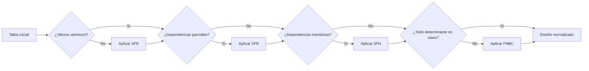

---

## 7. Esquema-resumen

| Concepto | Idea clave |
|---|---|
| Modelo E/R | Entidades, atributos y relaciones con cardinalidad (1:1, 1:N, N:M) |
| Entidad débil | Se identifica con la clave de la fuerte + discriminador |
| E/R ampliado | Jerarquías: generalización/especialización, disjunta/solapada, total/parcial |
| Modelo relacional | Tablas con atributos atómicos, sin duplicados, con PK |
| Claves | PK, candidata, alternativa, FK |
| Integridad | Entidad, referencial, dominio, usuario |
| E/R → relacional | Entidad→tabla; 1:N→FK; N:M→tabla intermedia; débil→PK compuesta |
| Restricciones no plasmables | Documentarlas e implementarlas con triggers/CHECK/aplicación |
| Normalización | 1FN (atómico) → 2FN (sin parciales) → 3FN (sin transitivas) → FNBC |

---

## 8. Glosario de términos clave

| Término | Definición |
|---|---|
| **Atributo** | Propiedad de una entidad o relación |
| **Cardinalidad** | Número de ocurrencias de una entidad que se asocian con otra |
| **Clave ajena** | Atributo que referencia la clave primaria de otra tabla |
| **Clave candidata** | Conjunto mínimo de atributos que identifica una tupla |
| **Clave primaria** | Candidata elegida para identificar las filas; única y no nula |
| **Dependencia funcional** | Relación `A → B` donde A determina B |
| **Dominio** | Conjunto de valores válidos de un atributo |
| **Entidad débil** | Entidad que no se identifica sin otra entidad propietaria |
| **Generalización / especialización** | Creación de superentidades o subentidades |
| **Integridad referencial** | Toda FK debe ser nula o existir en la tabla referenciada |
| **Normalización** | Proceso de descomposición para eliminar redundancias y anomalías |
| **Relación (E/R)** | Asociación entre entidades |
| **Relación (modelo relacional)** | Tabla |
| **Tupla** | Fila de una tabla |
