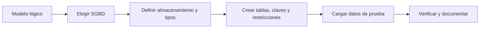

# Unidad 3 - Diseño físico de bases de datos <!-- omit from toc -->

**Módulo:** Gestión de bases de datos

**RA3:** Realiza el diseño físico de bases de datos utilizando asistentes, herramientas gráficas y el lenguaje de definición de datos.

---

## 1. Del diseño lógico al diseño físico

*(CE-a, CE-b, CE-c, CE-d, CE-e: se definen el almacenamiento, las tablas, los tipos de datos, las claves y las restricciones.)*

El **diseño físico** transforma el esquema relacional obtenido en el diseño lógico en objetos concretos de un SGBD: bases de datos, tablas, columnas, índices, restricciones y, cuando procede, estructuras de almacenamiento. A diferencia del modelo lógico, el diseño físico depende del producto utilizado (MySQL/MariaDB, PostgreSQL, SQL Server, etc.).

| Nivel | Pregunta | Ejemplo |
|---|---|---|
| Conceptual | ¿Qué objetos existen y cómo se relacionan? | Cliente realiza pedidos |
| Lógico | ¿Qué tablas, atributos y claves representan esos objetos? | `CLIENTE`, `PEDIDO`, `LINEA_PEDIDO` |
| Físico | ¿Cómo se crean en un SGBD concreto? | `CREATE TABLE`, tipos, índices y restricciones |

En esta unidad se utilizará **SQL estándar con sintaxis compatible con MySQL/MariaDB**. Algunas opciones, como el motor `InnoDB` o `AUTO_INCREMENT`, son específicas de esta familia y deben adaptarse si se usa otro SGBD.



---

## 2. Herramientas gráficas del SGBD

*(CE-g: se han utilizado asistentes y herramientas gráficas.)*

Los SGBD suelen proporcionar una consola y herramientas gráficas. Una herramienta gráfica permite inspeccionar objetos, crear tablas mediante formularios, editar diagramas, importar datos y consultar resultados sin escribir todas las instrucciones manualmente. Sin embargo, normalmente genera sentencias DDL internamente; por ello es importante revisar y guardar el script generado.

### 2.1. Funciones habituales

- **Conexión:** configurar servidor, puerto, usuario y base de datos.
- **Navegador de objetos:** consultar bases de datos, tablas, vistas, índices y restricciones.
- **Asistente de creación de tablas:** introducir columnas, tipos, valores predeterminados y claves.
- **Editor E/R o de esquema:** representar tablas y relaciones.
- **Editor SQL:** ejecutar scripts y visualizar errores y resultados.
- **Importación/exportación:** cargar datos CSV y generar copias o scripts.
- **Diseñador de consultas:** construir consultas de forma visual.

Ejemplos de herramientas son MySQL Workbench, DBeaver, phpMyAdmin y las herramientas equivalentes incluidas en otros SGBD.

### 2.2. Procedimiento gráfico

1. Abrir la conexión al servidor.
2. Crear o seleccionar el esquema de trabajo.
3. Usar **Crear tabla** y añadir las columnas.
4. Marcar la clave primaria y configurar las claves ajenas.
5. Añadir restricciones `NOT NULL`, `UNIQUE`, `CHECK` y valores predeterminados.
6. Guardar y revisar el SQL que la herramienta va a ejecutar.
7. Actualizar el navegador de objetos y comprobar la estructura.

> **Buenas prácticas:** la herramienta gráfica ayuda a aprender y administrar, pero el script DDL debe conservarse en el proyecto para que la estructura sea reproducible y auditable.

---

## 3. El lenguaje de definición de datos (DDL)

*(CE-h: se ha utilizado el lenguaje de definición de datos.)*

El **DDL (Data Definition Language)** es el subconjunto de SQL que define y modifica la estructura de la base de datos. Sus instrucciones no describen filas concretas, sino objetos y reglas.

| Instrucción | Finalidad | Ejemplo |
|---|---|---|
| `CREATE` | Crear un objeto | `CREATE TABLE cliente (...)` |
| `ALTER` | Modificar un objeto existente | `ALTER TABLE cliente ADD ...` |
| `DROP` | Eliminar un objeto | `DROP TABLE cliente` |
| `TRUNCATE` | Vaciar todas las filas conservando la tabla | `TRUNCATE TABLE cliente` |

`INSERT`, `UPDATE` y `DELETE` pertenecen al lenguaje de manipulación de datos (DML), aunque se utilizarán en esta unidad para preparar los datos de prueba.

### 3.1. Crear y seleccionar una base de datos

```sql
CREATE DATABASE tienda
    CHARACTER SET utf8mb4
    COLLATE utf8mb4 Spanish_CI;

USE tienda;
```

`utf8mb4` permite almacenar correctamente caracteres internacionales, incluidos símbolos y emojis. En un entorno donde la intercalación `Spanish_CI` no exista, se debe elegir la disponible y documentar la decisión.

Para evitar errores al repetir un script durante las prácticas:

```sql
CREATE DATABASE IF NOT EXISTS tienda
    CHARACTER SET utf8mb4;
```

### 3.2. Modificar y eliminar bases de datos

El nombre y las opciones de una base de datos pueden modificarse mediante instrucciones específicas del SGBD. La eliminación es destructiva:

```sql
DROP DATABASE tienda;
```

No se debe ejecutar `DROP DATABASE` en producción sin copia de seguridad y autorización. `IF EXISTS` evita el error si el objeto ya no existe, pero no evita la pérdida de datos:

```sql
DROP DATABASE IF EXISTS tienda;
```

---

## 4. Estructuras físicas de almacenamiento

*(CE-a: se han definido las estructuras físicas de almacenamiento.)*

Las estructuras físicas determinan cómo se conservan y recuperan los datos. Según el SGBD, incluyen:

- **Archivos de datos:** almacenan las páginas o bloques de las tablas. Aunque no aparezcan normalmente en `CREATE TABLE`, toda base de datos necesita una representación física en uno o varios archivos administrados por el motor.
- **Espacios de tablas (tablespaces):** agrupan archivos y permiten ubicar objetos.
- **Motor de almacenamiento:** controla transacciones, bloqueos, recuperación e índices.
- **Páginas y extensiones:** unidades de asignación de espacio.
- **Índices:** estructuras auxiliares, habitualmente B-tree, que aceleran búsquedas.
- **Particiones:** dividen una tabla grande según un criterio, como año o rango de identificadores.

En MariaDB/MySQL, `InnoDB` suele ser la elección general porque ofrece transacciones, claves ajenas y recuperación ante fallos:

```sql
CREATE TABLE cliente (
    id_cliente INT UNSIGNED NOT NULL AUTO_INCREMENT,
    nombre VARCHAR(80) NOT NULL,
    email VARCHAR(150) NOT NULL,
    PRIMARY KEY (id_cliente),
    UNIQUE KEY uq_cliente_email (email)
) ENGINE = InnoDB;
```

En esta sentencia no se indica ningún archivo porque `InnoDB` lo crea y administra según la configuración del servidor. En una instalación con `innodb_file_per_table` activo, lo habitual es que cada tabla tenga un archivo de datos propio, normalmente con extensión `.ibd`, dentro del directorio de datos del esquema. También existen archivos globales del sistema, como el espacio de tablas compartido y los registros de transacciones. El nombre, ubicación y formato de esos archivos son detalles de administración, no columnas ni restricciones de la tabla.

La ubicación física de los archivos se deja normalmente bajo control del administrador del SGBD. El diseñador debe documentar las decisiones que afectan al comportamiento: motor, codificación, índices, particionamiento y política de copias de seguridad.

### 4.1. Tablespaces

Un **tablespace** es un espacio lógico que agrupa uno o más archivos físicos y permite separar determinados objetos del espacio de almacenamiento predeterminado. Puede utilizarse, por ejemplo, para ubicar datos de una aplicación en un disco diferente o para aplicar una política de copia de seguridad independiente.

En MySQL con InnoDB, un administrador puede crear un tablespace general indicando su archivo físico:

```sql
CREATE TABLESPACE ts_tienda
    ADD DATAFILE 'C:/mysql/data/ts_tienda.ibd'
    ENGINE = InnoDB;
```

Después se puede crear una tabla dentro de ese tablespace:

```sql
CREATE TABLE auditoria (
    id_auditoria BIGINT UNSIGNED NOT NULL AUTO_INCREMENT,
    fecha_evento DATETIME NOT NULL,
    descripcion VARCHAR(500) NOT NULL,
    PRIMARY KEY (id_auditoria)
) ENGINE = InnoDB
  TABLESPACE ts_tienda;
```

También se puede asignar una tabla ya existente:

```sql
ALTER TABLE auditoria
    TABLESPACE ts_tienda;
```

Para eliminar el tablespace, primero hay que eliminar o trasladar las tablas que contiene:

```sql
DROP TABLESPACE ts_tienda
    ENGINE = InnoDB;
```

Estas sentencias son específicas de MySQL/InnoDB, requieren privilegios de administración y la ruta debe existir y cumplir las reglas de seguridad del servidor. No se debe elegir una ruta arbitraria desde una aplicación. PostgreSQL, SQL Server y otros SGBD utilizan una sintaxis diferente; por tanto, el diseño físico debe documentar siempre el producto concreto y su versión.

### 4.2. Índices y rendimiento

Un índice evita recorrer todas las filas para localizar valores, pero ocupa espacio y ralentiza las escrituras. Se deben indexar las claves primarias y, normalmente, las ajenas y columnas usadas frecuentemente para buscar:

Sintaxis general para crear un índice:

```sql
CREATE [UNIQUE] INDEX nombre_indice
    ON nombre_tabla (columna [ASC|DESC], ...);
```

Los tipos más habituales son:

- **Índice de clave primaria:** se crea con `PRIMARY KEY`; identifica las filas y solo puede existir uno por tabla.
- **Índice único:** se crea con `UNIQUE`; impide valores repetidos en una columna o combinación de columnas.
- **Índice no único:** se crea con `CREATE INDEX`; acelera búsquedas y permite repetidos.
- **Índice compuesto:** utiliza varias columnas. El orden importa y se aprovecha especialmente desde la primera columna.
- **Índice de texto completo:** `FULLTEXT`; busca palabras dentro de textos y no sustituye a un índice B-tree convencional.
- **Índice espacial:** `SPATIAL`; se utiliza con datos geográficos compatibles, como `POINT` o `POLYGON`.

Las claves ajenas no siempre crean automáticamente un índice en todos los SGBD. Por ello, si se consulta o se combina habitualmente por una FK, se puede crear uno:

```sql
CREATE INDEX ix_pedido_fecha
    ON pedido (fecha_pedido);

CREATE INDEX ix_pedido_cliente_fecha
    ON pedido (id_cliente, fecha_pedido);

CREATE UNIQUE INDEX uq_cliente_email
    ON cliente (email);
```

Para eliminar un índice:

```sql
DROP INDEX ix_pedido_fecha ON pedido;
```

No conviene crear índices indiscriminadamente: antes de añadirlos se analiza el uso real mediante las herramientas del SGBD y `EXPLAIN`.

---

## 5. Creación de tablas

*(CE-b: se han creado tablas.)*

La sintaxis general es:

```sql
CREATE TABLE nombre_tabla (
    columna tipo [opciones],
    ...
    [restricciones_de_tabla]
);
```

Se recomienda usar nombres consistentes, en singular o plural según la convención del proyecto, evitar espacios y palabras reservadas, y declarar explícitamente las restricciones.

Ejemplo de un pequeño modelo de tienda:

```sql
CREATE TABLE cliente (
    id_cliente INT UNSIGNED NOT NULL AUTO_INCREMENT,
    nombre VARCHAR(80) NOT NULL,
    email VARCHAR(150) NOT NULL,
    fecha_alta DATE NOT NULL DEFAULT (CURRENT_DATE),
    PRIMARY KEY (id_cliente),
    CONSTRAINT uq_cliente_email UNIQUE (email)
) ENGINE = InnoDB;

CREATE TABLE pedido (
    id_pedido INT UNSIGNED NOT NULL AUTO_INCREMENT,
    id_cliente INT UNSIGNED NOT NULL,
    fecha_pedido DATETIME NOT NULL DEFAULT CURRENT_TIMESTAMP,
    estado VARCHAR(12) NOT NULL DEFAULT 'pendiente',
    PRIMARY KEY (id_pedido),
    CONSTRAINT fk_pedido_cliente
        FOREIGN KEY (id_cliente) REFERENCES cliente (id_cliente),
    CONSTRAINT ck_pedido_estado
        CHECK (estado IN ('pendiente', 'pagado', 'enviado', 'cancelado'))
) ENGINE = InnoDB;
```

La tabla que contiene la clave ajena debe crearse después de la tabla referenciada. En este ejemplo, `pedido.id_cliente` representa la relación 1:N del modelo lógico: un cliente puede realizar varios pedidos y cada pedido pertenece a un cliente.

---

## 6. Selección de tipos de datos

*(CE-c: se han seleccionado los tipos de datos adecuados.)*

El tipo debe representar el dominio real del atributo, limitar valores inválidos y evitar un consumo innecesario de almacenamiento.

Las tablas siguientes resumen los tipos disponibles actualmente en MySQL 8.x y MariaDB modernas. El tamaño indicado es el almacenamiento aproximado del valor; en `VARCHAR`, `TEXT`, `DECIMAL` y tipos temporales puede aumentar por la codificación, los metadatos o los decimales de precisión. Otros SGBD tienen nombres, rangos o tamaños diferentes.

### 6.1. Tipos numéricos

#### Enteros

| Tipo | Bytes | Con signo | `UNSIGNED` | Uso recomendado | Ejemplo de uso |
|---|---:|---:|---:|---|---|
| `TINYINT` | 1 | -128 a 127 | 0 a 255 | Estados pequeños, contadores y booleanos | `activo BOOLEAN` o `edad TINYINT UNSIGNED` |
| `SMALLINT` | 2 | -32.768 a 32.767 | 0 a 65.535 | Cantidades o códigos con pocos valores | `unidades SMALLINT UNSIGNED` |
| `MEDIUMINT` | 3 | -8.388.608 a 8.388.607 | 0 a 16.777.215 | Identificadores o contadores intermedios | `visitas MEDIUMINT UNSIGNED` |
| `INT` / `INTEGER` | 4 | -2.147.483.648 a 2.147.483.647 | 0 a 4.294.967.295 | Opción general e identificadores habituales | `id_cliente INT UNSIGNED` |
| `BIGINT` | 8 | -2^63 a 2^63-1 | 0 a 2^64-1 | Contadores masivos o identificadores distribuidos | `id_evento BIGINT UNSIGNED` |

`TINYINT` ocupa un byte, por lo que es adecuado para un valor que nunca superará 255, como un porcentaje, un contador pequeño o un indicador. `BOOLEAN` y `BOOL` son sinónimos de `TINYINT(1)` en MySQL/MariaDB; se recomienda escribir `BOOLEAN` para expresar la intención, aunque internamente se almacene como entero.

`SMALLINT` y `MEDIUMINT` permiten ahorrar espacio frente a `INT` cuando el dominio está bien conocido. `INT` suele ser la elección equilibrada para claves primarias y foráneas. `BIGINT` ocupa el doble que `INT`, por lo que solo se debe utilizar si el número de filas, el contador o la generación distribuida de identificadores lo justifica. 

El atributo `UNSIGNED` elimina valores negativos y amplía el máximo positivo. La clave primaria y su clave ajena deben tener exactamente el mismo tipo y atributos relevantes, incluido `UNSIGNED`.

#### Decimales y números aproximados

| Tipo | Almacenamiento | Precisión y uso | Ejemplo de uso |
|---|---:|---|---|
| `DECIMAL(p,s)` / `NUMERIC(p,s)` | Variable, según `p` | Exacto; `p` es el total de dígitos y `s` los decimales | `precio DECIMAL(10,2)` |
| `FLOAT` | 4 bytes | Aproximado, precisión simple | `temperatura FLOAT` |
| `DOUBLE` / `REAL` | 8 bytes | Aproximado, precisión doble | `latitud DOUBLE` |
| `BIT(M)` | 1 a 8 bytes para `M` hasta 64 | Conjunto de bits; `BIT(1)` puede representar un indicador | `permisos BIT(8)` |

Para dinero se debe usar `DECIMAL(10,2)`, no `FLOAT` ni `DOUBLE`, porque los tipos aproximados pueden producir errores de redondeo binario. `DECIMAL(10,2)` admite diez dígitos en total, dos de ellos decimales, por lo que permite valores desde `-99999999.99` hasta `99999999.99` (o desde cero si se añade `UNSIGNED`).

### 6.2. Tipos de caracteres y texto

| Tipo | Tamaño máximo | Características y uso | Ejemplo de uso |
|---|---:|---|---|
| `CHAR(n)` | 0-255 caracteres | Longitud fija; códigos, DNI o estados de tamaño uniforme | `pais CHAR(2)` |
| `VARCHAR(n)` | Hasta 65.535 bytes por fila | Longitud variable; nombres, correos y títulos | `email VARCHAR(150)` |
| `TINYTEXT` | 255 bytes | Texto corto | `nota TINYTEXT` |
| `TEXT` | 65.535 bytes (64 KiB) | Descripciones y observaciones | `descripcion TEXT` |
| `MEDIUMTEXT` | 16.777.215 bytes (16 MiB) | Documentos o textos largos | `articulo MEDIUMTEXT` |
| `LONGTEXT` | 4.294.967.295 bytes (4 GiB) | Textos muy extensos; usar con cautela | `contenido LONGTEXT` |
| `ENUM` | Hasta 65.535 valores | Una opción de una lista cerrada | `estado ENUM('borrador','publicado')` |
| `SET` | Hasta 64 opciones | Cero o varias opciones de una lista | `dias SET('L','M','X','J','V')` |

`CHAR` reserva una longitud fija y es apropiado cuando todos los valores tienen el mismo tamaño. `VARCHAR` almacena solo la longitud necesaria más una pequeña cabecera, por lo que es la opción habitual para texto variable. El límite real depende de la codificación y del máximo de bytes permitido por una fila; con `utf8mb4`, un carácter puede ocupar hasta cuatro bytes.

`TEXT` y sus variantes sirven para contenido largo, pero no permiten un valor predeterminado en algunas versiones y suelen requerir prefijos para indexarse. Para descripciones normales es preferible `VARCHAR` con un límite documentado. `ENUM` y `SET` son tipos válidos actuales, pero para dominios que cambian con frecuencia suele ser más flexible una tabla relacionada y una clave ajena.

Todos los tipos de texto deben usar una codificación adecuada, normalmente `utf8mb4`:

```sql
CREATE TABLE articulo (
    titulo VARCHAR(150) CHARACTER SET utf8mb4 NOT NULL,
    resumen TEXT CHARACTER SET utf8mb4,
    idioma CHAR(2) CHARACTER SET ascii NOT NULL
);
```

### 6.3. Tipos de fecha y hora

| Tipo | Bytes aproximados | Rango o precisión | Uso | Ejemplo de uso |
|---|---:|---|---|---|
| `DATE` | 3 | `1000-01-01` a `9999-12-31` | Fecha sin hora | `fecha_nacimiento DATE` |
| `DATETIME` | 5; hasta 8 con fracciones | `1000-01-01` a `9999-12-31`, precisión 0-6 | Fecha y hora independientes de la zona horaria | `cita DATETIME` |
| `TIMESTAMP` | 4; hasta 7 con fracciones | `1970-01-01` a `2038-01-19` en MySQL tradicional, precisión 0-6 | Instantes gestionados y convertidos según zona horaria | `creado_en TIMESTAMP` |
| `TIME` | 3; hasta 6 con fracciones | `-838:59:59` a `838:59:59` | Hora o duración | `duracion TIME` |
| `YEAR` | 1 | Año de cuatro dígitos | Año aislado | `anio_publicacion YEAR` |

Se debe usar `DATE` para una fecha de nacimiento o una fecha de factura si no interesa la hora. `DATETIME` es adecuado para citas o registros de un sistema que deben conservar la hora escrita. `TIMESTAMP` resulta útil para `created_at` y `updated_at`, especialmente cuando se desea conversión automática de zona horaria, pero su rango es más limitado. `TIME` no representa una fecha: también puede expresar una duración.

Ejemplo:

```sql
CREATE TABLE evento (
    fecha_evento DATE NOT NULL,
    inicio DATETIME(6) NOT NULL,
    creado_en TIMESTAMP NOT NULL DEFAULT CURRENT_TIMESTAMP,
    duracion TIME
);
```

No se deben guardar fechas como `VARCHAR`: se perderían validación, ordenación y funciones específicas de fecha.

### 6.4. Tipos binarios y otros tipos actuales

| Tipo | Tamaño máximo | Uso | Ejemplo de uso |
|---|---:|---|---|
| `BINARY(n)` | 0-255 bytes | Binario de longitud fija, hashes o códigos | `hash BINARY(32)` |
| `VARBINARY(n)` | Hasta 65.535 bytes | Binario de longitud variable | `token VARBINARY(128)` |
| `TINYBLOB` | 255 bytes | Binario corto | `icono TINYBLOB` |
| `BLOB` | 65.535 bytes | Imágenes o archivos pequeños | `miniatura BLOB` |
| `MEDIUMBLOB` | 16.777.215 bytes | Archivos medianos | `archivo MEDIUMBLOB` |
| `LONGBLOB` | 4.294.967.295 bytes | Binarios muy grandes | `copia LONGBLOB` |
| `JSON` | Hasta el límite de una fila | Documentos JSON validados y consultables | `preferencias JSON` |
| Tipos espaciales (`POINT`, `LINESTRING`, `POLYGON`, `GEOMETRY`) | Variable | Coordenadas y geometría | `ubicacion POINT` |

`BINARY` y `VARBINARY` almacenan bytes y no texto. `BLOB` y sus variantes están pensados para contenido binario grande; para archivos voluminosos suele ser preferible almacenar el archivo en un sistema de ficheros u objeto externo y guardar en la base de datos su identificador, ruta, tamaño y tipo MIME.

`JSON` es un tipo actual para datos semiestructurados, pero no debe utilizarse para ocultar un diseño relacional estable: si un atributo se consulta, relaciona o valida habitualmente, normalmente debe ser una columna. Los tipos espaciales se emplean en sistemas geográficos y requieren funciones espaciales e índices específicos.

Decisiones generales:

- Elegir el tipo más pequeño que cubra todos los valores válidos, sin anticipar rangos irreales.
- Usar `DECIMAL` para importes y mediciones que requieran exactitud; `FLOAT` o `DOUBLE` solo si se acepta aproximación.
- Usar `DATE`, `TIME`, `DATETIME` o `TIMESTAMP` según la información temporal necesaria.
- Elegir una longitud de texto coherente con el dominio y documentarla.
- Usar `UNSIGNED` cuando el dominio no admite negativos, siempre que el SGBD lo soporte.
- No confundir `NULL` con cero, cadena vacía o `FALSE`: `NULL` significa que el valor es desconocido o no aplicable.

Ejemplo:

```sql
CREATE TABLE producto (
    id_producto INT UNSIGNED NOT NULL AUTO_INCREMENT,
    nombre VARCHAR(100) NOT NULL,
    descripcion TEXT,
    precio DECIMAL(10,2) NOT NULL,
    stock INT UNSIGNED NOT NULL DEFAULT 0,
    activo BOOLEAN NOT NULL DEFAULT TRUE,
    PRIMARY KEY (id_producto),
    CONSTRAINT ck_producto_precio CHECK (precio >= 0)
);
```

---

## 7. Claves y restricciones

*(CE-d y CE-e: se han definido los campos clave y se han implantado las restricciones del diseño lógico.)*

### 7.1. Claves

- **Clave primaria (`PRIMARY KEY`):** identifica de forma única cada fila; no admite valores nulos.
- **Clave candidata:** cualquier conjunto mínimo de columnas que podría ser clave primaria.
- **Clave alternativa:** candidata no elegida como primaria; suele implementarse con `UNIQUE`.
- **Clave ajena (`FOREIGN KEY`):** referencia una clave de otra tabla y mantiene la integridad referencial.
- **Clave compuesta:** combina varias columnas, habitual en tablas intermedias N:M.

#### Claves numéricas autoincrementales

`AUTO_INCREMENT` no es un tipo de índice, sino un atributo de una columna entera. Hace que el SGBD genere automáticamente un valor nuevo cuando se inserta una fila sin indicar esa columna. Se utiliza habitualmente en una clave primaria sustituta:

```sql
CREATE TABLE cliente (
    id_cliente INT UNSIGNED NOT NULL AUTO_INCREMENT,
    nombre VARCHAR(80) NOT NULL,
    PRIMARY KEY (id_cliente)
);
```

Al insertar, no es necesario proporcionar `id_cliente`:

```sql
INSERT INTO cliente (nombre)
VALUES ('Ana García');
```

El SGBD asignará el siguiente identificador disponible. El contador puede comenzar en un valor concreto al crear la tabla:

```sql
CREATE TABLE pedido (
    id_pedido INT UNSIGNED NOT NULL AUTO_INCREMENT,
    fecha_pedido DATETIME NOT NULL,
    PRIMARY KEY (id_pedido)
) AUTO_INCREMENT = 1000;
```

En este caso, el primer pedido generado será normalmente `1000`. También se puede establecer el próximo valor de una tabla ya creada:

```sql
ALTER TABLE pedido AUTO_INCREMENT = 1000;
```

El valor indicado debe ser mayor que el identificador máximo existente; si ya hay filas con identificadores superiores, el SGBD no reutiliza esos valores. Al borrar una fila, su identificador no se reutiliza necesariamente, por lo que `AUTO_INCREMENT` no garantiza una numeración consecutiva sin huecos. Tampoco debe utilizarse como sustituto de una restricción `UNIQUE` para otros campos, ni como forma de ordenar cronológicamente las filas.

### 7.2. Sintaxis general de claves y restricciones

Las restricciones pueden escribirse junto a la columna o como restricciones de tabla. La segunda forma es especialmente clara para claves compuestas y claves ajenas:

```sql
CREATE TABLE tabla_hija (
    id INT NOT NULL,
    codigo VARCHAR(20) NOT NULL,
    id_padre INT NULL,
    cantidad INT UNSIGNED NOT NULL DEFAULT 1,

    CONSTRAINT pk_tabla_hija
        PRIMARY KEY (id),
    CONSTRAINT uq_tabla_hija_codigo
        UNIQUE (codigo),
    CONSTRAINT fk_hija_padre
        FOREIGN KEY (id_padre)
        REFERENCES tabla_padre (id)
        ON DELETE SET NULL
        ON UPDATE CASCADE,
    CONSTRAINT ck_hija_cantidad
        CHECK (cantidad > 0)
);
```

Formas básicas:

```sql
-- Campo obligatorio: no admite NULL.
nombre VARCHAR(80) NOT NULL

-- Campo opcional: admite NULL.
observaciones TEXT NULL

-- Clave primaria de una columna.
CONSTRAINT pk_ejemplo PRIMARY KEY (id)

-- Clave primaria compuesta.
CONSTRAINT pk_linea PRIMARY KEY (id_pedido, id_producto)

-- Clave alternativa o índice único.
CONSTRAINT uq_ejemplo_codigo UNIQUE (codigo)

-- Clave ajena.
CONSTRAINT fk_ejemplo_padre
    FOREIGN KEY (id_padre)
    REFERENCES tabla_padre (id)
```

`NOT NULL` se escribe en la definición de la columna y obliga a proporcionar un valor. Una clave ajena puede ser `NULL` si la relación es opcional; si la relación es obligatoria, se declara también `NOT NULL`.

Las acciones referenciales se colocan después de `REFERENCES`:

```sql
FOREIGN KEY (id_padre)
REFERENCES tabla_padre (id)
ON DELETE RESTRICT
ON UPDATE CASCADE
```

- `ON DELETE RESTRICT` o `NO ACTION`: impide borrar la fila padre mientras tenga hijas.
- `ON DELETE CASCADE`: borra automáticamente las filas hijas relacionadas.
- `ON DELETE SET NULL`: establece la FK a `NULL`; la columna debe admitir nulos.
- `ON UPDATE CASCADE`: actualiza las FKs si cambia la clave padre.
- `ON UPDATE RESTRICT` o `NO ACTION`: impide modificar la clave padre si tiene referencias.
- `ON UPDATE SET NULL`: establece la FK a `NULL` cuando cambia la clave padre.

La elección depende de la regla de negocio. `CASCADE` no debe utilizarse solo para evitar errores: puede borrar o modificar muchas filas de forma automática.

### 7.3. Ejemplo de claves y restricciones

```sql
CREATE TABLE linea_pedido (
    id_pedido INT UNSIGNED NOT NULL,
    id_producto INT UNSIGNED NOT NULL,
    cantidad INT UNSIGNED NOT NULL,
    precio_unitario DECIMAL(10,2) NOT NULL,
    PRIMARY KEY (id_pedido, id_producto),
    CONSTRAINT fk_linea_pedido
        FOREIGN KEY (id_pedido) REFERENCES pedido (id_pedido)
        ON DELETE CASCADE,
    CONSTRAINT fk_linea_producto
        FOREIGN KEY (id_producto) REFERENCES producto (id_producto),
    CONSTRAINT ck_linea_cantidad CHECK (cantidad > 0),
    CONSTRAINT ck_linea_precio CHECK (precio_unitario >= 0)
) ENGINE = InnoDB;
```

La clave compuesta impide que el mismo producto aparezca dos veces en un pedido. `ON DELETE CASCADE` expresa que las líneas no tienen sentido sin su pedido; debe utilizarse únicamente cuando esa sea la regla de negocio.

### 7.4. Restricciones de integridad

| Restricción | Garantiza | Ejemplo |
|---|---|---|
| `NOT NULL` | El atributo es obligatorio | `nombre VARCHAR(80) NOT NULL` |
| `PRIMARY KEY` | Identidad y unicidad de la fila | `PRIMARY KEY (id_cliente)` |
| `UNIQUE` | No hay duplicados en una columna o combinación | `UNIQUE (email)` |
| `FOREIGN KEY` | Integridad entre tablas | `REFERENCES cliente(id_cliente)` |
| `CHECK` | El valor pertenece al dominio | `CHECK (precio >= 0)` |
| `DEFAULT` | Valor si no se proporciona uno | `DEFAULT 'pendiente'` |

Las acciones referenciales deben elegirse con cuidado:

- `ON DELETE RESTRICT` o `NO ACTION`: impide borrar si existen filas dependientes.
- `ON DELETE CASCADE`: borra automáticamente las filas dependientes.
- `ON DELETE SET NULL`: deja la referencia a `NULL`, por lo que la columna debe permitir nulos.

### 7.5. Modificar tablas

```sql
ALTER TABLE producto
    ADD COLUMN codigo_barras VARCHAR(13);

ALTER TABLE producto
    ADD CONSTRAINT uq_producto_codigo UNIQUE (codigo_barras);

ALTER TABLE producto
    MODIFY COLUMN nombre VARCHAR(120) NOT NULL;
```

Para eliminar una restricción se utiliza su nombre:

```sql
ALTER TABLE producto
    DROP CONSTRAINT uq_producto_codigo;
```

### 7.6. Renombrar objetos

Renombrar también es una operación DDL de modificación. Se debe hacer con cuidado porque las consultas, vistas, procedimientos, aplicaciones y documentación que utilicen el nombre anterior pueden dejar de funcionar.

Para renombrar una tabla en MySQL/MariaDB:

```sql
RENAME TABLE cliente TO usuario;
```

También se puede utilizar `ALTER TABLE`:

```sql
ALTER TABLE usuario
    RENAME TO cliente;
```

Para renombrar una columna en MySQL:

```sql
ALTER TABLE cliente
    RENAME COLUMN nombre TO nombre_completo;
```

Para cambiar el nombre de una base de datos no existe una instrucción `RENAME DATABASE` general y segura en MySQL/MariaDB. El procedimiento habitual es crear la nueva base de datos, migrar sus objetos y datos y, después de comprobar la copia, eliminar la antigua:

```sql
CREATE DATABASE tienda_nueva;

-- A continuación se exportan/importan las tablas y datos de tienda
-- mediante mysqldump, una herramienta gráfica o scripts DDL/DML.
```

No se debe simular un cambio de nombre copiando solo las tablas sin revisar claves ajenas, índices, vistas, triggers, permisos, procedimientos y conexiones de las aplicaciones.

La sintaxis exacta puede variar entre SGBD; conviene consultar la documentación y probar primero en una copia.

### 7.7. Eliminar tablas

```sql
DROP TABLE IF EXISTS linea_pedido;
DROP TABLE IF EXISTS pedido;
DROP TABLE IF EXISTS producto;
DROP TABLE IF EXISTS cliente;
```

El orden respeta las dependencias: primero se eliminan las tablas que contienen claves ajenas. `DROP` elimina estructura y datos, mientras que `TRUNCATE` conserva la estructura pero elimina todas las filas.

---

## 8. Vistas

*(CE-h: se ha utilizado el lenguaje de definición de datos.)*

Una **vista** es un objeto de la base de datos que guarda una consulta con nombre. No suele almacenar una copia independiente de las filas: cada vez que se consulta, el SGBD ejecuta la consulta definida sobre las tablas subyacentes, salvo mecanismos específicos de materialización que dependen del producto.

Las vistas sirven para:

- Ocultar columnas sensibles y mostrar solo los datos autorizados.
- Simplificar consultas repetitivas.
- Presentar una interfaz estable aunque cambie la estructura interna.
- Encapsular `JOIN`, filtros y cálculos.
- Proporcionar una representación de solo lectura para determinados usuarios.

Una vista no sustituye a una tabla cuando se necesita almacenar datos propios, y no garantiza por sí sola la seguridad: también hay que controlar los permisos. Además, una vista compleja puede ralentizar las consultas y no todas las vistas se pueden modificar mediante `INSERT`, `UPDATE` o `DELETE`.

### 8.1. Crear una vista

Sintaxis general:

```sql
CREATE [OR REPLACE] VIEW nombre_vista [(columna, ...)] AS
    SELECT ...
    [WITH [CASCADED | LOCAL] CHECK OPTION];
```

Ejemplo:

```sql
CREATE VIEW v_pedidos_clientes AS
SELECT p.id_pedido,
       c.nombre AS cliente,
       p.fecha_pedido,
       p.estado
FROM pedido AS p
JOIN cliente AS c ON c.id_cliente = p.id_cliente;
```

Después se consulta como si fuera una tabla:

```sql
SELECT *
FROM v_pedidos_clientes
WHERE estado = 'pendiente';
```

La vista no duplica normalmente los datos: almacena la definición de la consulta y obtiene los resultados de `cliente` y `pedido` cuando se utiliza.

### 8.2. Vistas actualizables y `CHECK OPTION`

Una vista sencilla basada en una sola tabla suele ser actualizable si incluye las columnas necesarias y no utiliza agrupaciones, agregaciones, `DISTINCT` u otras construcciones que impidan identificar las filas originales. En determinados SGBD también pueden ser actualizables algunos casos sencillos con `JOIN`, pero las reglas exactas dependen del producto.

`WITH CHECK OPTION` **no es necesario para que una vista sea actualizable**. Es una opción adicional que obliga a que las filas insertadas o modificadas a través de la vista sigan cumpliendo el filtro de su definición:

```sql
CREATE VIEW v_productos_activos AS
SELECT id_producto, nombre, precio, activo
FROM producto
WHERE activo = TRUE
WITH CHECK OPTION;
```

Sin `WITH CHECK OPTION`, la siguiente actualización puede ser válida, pero el producto dejaría de aparecer en `v_productos_activos` porque ya no cumple `activo = TRUE`:

```sql
UPDATE v_productos_activos
SET activo = FALSE
WHERE id_producto = 1;
```

Con `WITH CHECK OPTION`, esa modificación se rechaza porque haría que la fila dejase de pertenecer a la vista. Las vistas con `JOIN`, `GROUP BY`, `DISTINCT`, funciones de agregación o determinadas subconsultas suelen no ser actualizables. La posibilidad exacta depende del SGBD.

### 8.3. Modificar y eliminar vistas

Para reemplazar la definición sin eliminar la vista:

```sql
CREATE OR REPLACE VIEW v_pedidos_clientes AS
SELECT p.id_pedido,
       c.nombre AS cliente,
       p.fecha_pedido,
       p.estado,
       SUM(l.cantidad * l.precio_unitario) AS total
FROM pedido AS p
JOIN cliente AS c ON c.id_cliente = p.id_cliente
JOIN linea_pedido AS l ON l.id_pedido = p.id_pedido
GROUP BY p.id_pedido, c.nombre, p.fecha_pedido, p.estado;
```

Para eliminarla:

```sql
DROP VIEW IF EXISTS v_pedidos_clientes;
```

`DROP VIEW` elimina la definición de la vista, pero no borra las tablas ni los datos que consulta. Las vistas dependientes, permisos y objetos asociados deben revisarse antes de modificarla.

---

## 9. Usuarios, privilegios y lenguaje de control de datos

*(CE-g y CE-h: se utilizan las herramientas del SGBD y sus lenguajes de administración.)*

Una vez creadas las tablas, relaciones, índices y vistas, se define quién puede utilizar cada objeto. El **DCL (Data Control Language)** gestiona la seguridad de la base de datos: no crea tablas ni modifica directamente sus filas, sino que controla las conexiones y los privilegios.

| Instrucción | Finalidad |
|---|---|
| `CREATE USER` | Crear una cuenta de acceso |
| `ALTER USER` | Modificar una cuenta o sus credenciales |
| `DROP USER` | Eliminar una cuenta |
| `GRANT` | Conceder privilegios |
| `REVOKE` | Retirar privilegios |

Sintaxis general en MySQL/MariaDB:

```sql
CREATE USER 'nombre_usuario'@'origen'
    IDENTIFIED BY 'contraseña_segura';

GRANT privilegio [, privilegio ...]
    ON objeto
    TO 'nombre_usuario'@'origen';

REVOKE privilegio [, privilegio ...]
    ON objeto
    FROM 'nombre_usuario'@'origen';

DROP USER 'nombre_usuario'@'origen';
```

El origen `'localhost'` limita la conexión al propio servidor. El origen `'%'` permite conexiones desde cualquier origen y debe evitarse salvo que exista una política de red y autenticación adecuada.

### 9.1. Privilegios habituales

Los privilegios se conceden según la operación que el usuario necesita realizar:

| Privilegio | Permite | Ejemplo de necesidad |
|---|---|---|
| `SELECT` | Consultar filas y columnas | Usuario de informes |
| `INSERT` | Insertar filas | Aplicación que registra pedidos |
| `UPDATE` | Modificar filas | Aplicación que actualiza estados |
| `DELETE` | Eliminar filas | Proceso autorizado de limpieza |
| `EXECUTE` | Ejecutar procedimientos y funciones | Usuario de servicios almacenados |
| `CREATE` | Crear objetos en una base de datos | Usuario desarrollador |
| `ALTER` | Modificar tablas y otros objetos | Usuario encargado del esquema |
| `DROP` | Eliminar objetos | Administrador de la base de datos |
| `INDEX` | Crear o eliminar índices | Usuario de optimización |
| `REFERENCES` | Crear referencias mediante claves ajenas | Usuario que define relaciones |
| `CREATE VIEW` | Crear vistas | Usuario que diseña consultas reutilizables |
| `SHOW VIEW` | Consultar la definición de vistas | Usuario de documentación o administración |

`ALL PRIVILEGES` concede todos los privilegios disponibles en el nivel indicado. Es apropiado únicamente para una cuenta administrativa controlada y no para una aplicación:

```sql
GRANT ALL PRIVILEGES
    ON tienda.*
    TO 'tienda_admin'@'localhost';
```

El alcance indicado por `ON` es importante:

```sql
-- Toda la base de datos tienda.
GRANT SELECT ON tienda.* TO 'usuario'@'localhost';

-- Una tabla concreta.
GRANT SELECT, INSERT ON tienda.pedido TO 'usuario'@'localhost';

-- Una vista concreta.
GRANT SELECT ON tienda.v_pedidos_clientes TO 'usuario'@'localhost';
```

Ejemplo de separación de responsabilidades:

```sql
CREATE USER 'tienda_app'@'localhost'
    IDENTIFIED BY 'usar_un_secreto_gestionado';

CREATE USER 'tienda_lectura'@'localhost'
    IDENTIFIED BY 'usar_otro_secreto_gestionado';

GRANT SELECT, INSERT, UPDATE
    ON tienda.*
    TO 'tienda_app'@'localhost';

GRANT SELECT
    ON tienda.v_pedidos_clientes
    TO 'tienda_lectura'@'localhost';
```

### 9.2. `WITH GRANT OPTION`

`WITH GRANT OPTION` permite que el usuario que recibe un privilegio pueda conceder ese mismo privilegio a otras cuentas:

```sql
GRANT SELECT
    ON tienda.*
    TO 'tienda_supervisor'@'localhost'
    WITH GRANT OPTION;
```

Debe utilizarse con mucha cautela. Un usuario con esta opción puede propagar permisos y, si se revoca el privilegio original, también pueden revocarse los permisos concedidos por él, según las reglas del SGBD. Las cuentas de aplicación y de lectura no deben recibir `WITH GRANT OPTION`; se reserva para administradores o responsables de una delegación controlada.

También se pueden conceder permisos sobre columnas concretas:

```sql
GRANT SELECT (id_cliente, nombre, email)
    ON tienda.cliente
    TO 'tienda_lectura'@'localhost';
```

Para retirar un permiso y consultar los permisos efectivos:

```sql
REVOKE UPDATE
    ON tienda.*
    FROM 'tienda_app'@'localhost';

SHOW GRANTS FOR 'tienda_app'@'localhost';
```

Principios que deben documentarse en el diseño físico:

- Aplicar el **principio de mínimo privilegio**.
- No utilizar la cuenta administrativa desde una aplicación.
- Preferir permisos sobre vistas cuando se deban ocultar columnas o filas.
- Separar cuentas de aplicación, lectura, administración y copias de seguridad.
- No guardar contraseñas reales en scripts compartidos; usar un gestor de secretos.
- En instalaciones grandes, conceder privilegios a roles y asignar después esos roles a las cuentas.

La sintaxis y el sistema de roles pueden variar entre SGBD. Los permisos deben configurarse después de crear los objetos a los que se refieren y revisarse cuando se modifique el esquema.

---

## 10. Datos de prueba y verificación

*(CE-f: se ha verificado con datos de prueba que la implementación se ajusta al modelo.)*

Los datos de prueba deben incluir casos válidos, valores límite y operaciones que deben rechazarse. No basta con comprobar que las tablas existen.

```sql
INSERT INTO cliente (nombre, email)
VALUES ('Ana García', 'ana@example.com'),
       ('Luis Martín', 'luis@example.com');

INSERT INTO producto (nombre, precio, stock)
VALUES ('Teclado', 29.90, 15),
       ('Ratón', 14.50, 30);

INSERT INTO pedido (id_cliente, estado)
VALUES (1, 'pendiente');

INSERT INTO linea_pedido (id_pedido, id_producto, cantidad, precio_unitario)
VALUES (1, 1, 2, 29.90),
       (1, 2, 1, 14.50);
```

Pruebas de consulta y cardinalidad:

```sql
SELECT c.nombre, p.id_pedido, p.estado
FROM cliente AS c
JOIN pedido AS p ON p.id_cliente = c.id_cliente
ORDER BY p.id_pedido;

SELECT p.id_pedido,
       SUM(l.cantidad * l.precio_unitario) AS total
FROM pedido AS p
JOIN linea_pedido AS l ON l.id_pedido = p.id_pedido
GROUP BY p.id_pedido;
```

Pruebas negativas esperadas:

```sql
-- Debe fallar: correo duplicado (UNIQUE).
INSERT INTO cliente (nombre, email)
VALUES ('Otra persona', 'ana@example.com');

-- Debe fallar: no existe el cliente 999 (FOREIGN KEY).
INSERT INTO pedido (id_cliente, estado)
VALUES (999, 'pendiente');

-- Debe fallar: estado fuera del dominio (CHECK).
INSERT INTO pedido (id_cliente, estado)
VALUES (1, 'recibido');

-- Debe fallar: cantidad no positiva (CHECK).
INSERT INTO linea_pedido (id_pedido, id_producto, cantidad, precio_unitario)
VALUES (1, 1, 0, 29.90);
```

La prueba se documenta anotando la sentencia, el resultado esperado, el resultado obtenido y la evidencia (mensaje de error, consulta o captura de la herramienta gráfica). También se puede revisar la definición:

```sql
SHOW CREATE TABLE pedido;
SHOW CREATE TABLE linea_pedido;
```

---

## 11. Diccionario de datos

*(CE-i: se ha definido y documentado el diccionario de datos.)*

El **diccionario de datos** es el catálogo que describe los elementos de la base de datos: tabla, columna, tipo, obligatoriedad, clave, valor predeterminado, dominio, descripción y relaciones. Completa al esquema SQL porque explica el significado de cada dato.

Ejemplo de diccionario para `PEDIDO`:

| Tabla | Campo | Tipo | Nulo | Clave | Predeterminado | Descripción |
|---|---|---|---|---|---|---|
| `pedido` | `id_pedido` | `INT UNSIGNED` | No | PK | Auto | Identificador del pedido |
| `pedido` | `id_cliente` | `INT UNSIGNED` | No | FK | — | Cliente que realiza el pedido |
| `pedido` | `fecha_pedido` | `DATETIME` | No | — | Fecha actual | Momento de creación |
| `pedido` | `estado` | `VARCHAR(12)` | No | — | `pendiente` | Estado permitido del pedido |

El diccionario debe indicar también las reglas que no se deducen solo del tipo:

- `pedido.id_cliente` referencia `cliente.id_cliente`.
- `pedido.estado` solo admite `pendiente`, `pagado`, `enviado` o `cancelado`.
- `linea_pedido` tiene clave compuesta `(id_pedido, id_producto)`.
- `precio` y `precio_unitario` no pueden ser negativos.

### 11.1. Sentencias para documentar tablas y campos

En MySQL y MariaDB, la documentación se guarda como **comentarios del propio esquema** mediante la opción `COMMENT`. Es decir, `SHOW CREATE TABLE` o `INFORMATION_SCHEMA` no documentan por sí mismos: únicamente consultan los comentarios y metadatos que se hayan definido previamente.

El comentario de una tabla se puede establecer al crearla:

```sql
CREATE TABLE cliente (
    id_cliente INT UNSIGNED NOT NULL AUTO_INCREMENT
        COMMENT 'Identificador único del cliente',
    nombre VARCHAR(80) NOT NULL
        COMMENT 'Nombre y apellidos del cliente',
    email VARCHAR(150) NOT NULL
        COMMENT 'Correo electrónico; no se permiten duplicados',
    fecha_alta DATE NOT NULL DEFAULT (CURRENT_DATE)
        COMMENT 'Fecha de alta del cliente',
    PRIMARY KEY (id_cliente),
    CONSTRAINT uq_cliente_email UNIQUE (email)
) ENGINE = InnoDB
  COMMENT = 'Personas o empresas que realizan pedidos';
```

Si la tabla ya existe, se documenta con `ALTER TABLE`:

```sql
ALTER TABLE pedido
    COMMENT = 'Pedidos realizados por los clientes';
```

Para añadir o modificar el comentario de un campo en MySQL/MariaDB se utiliza `MODIFY COLUMN`. Hay que repetir la definición completa del campo para no perder su tipo, nulabilidad, valor predeterminado u otras opciones:

```sql
ALTER TABLE pedido
    MODIFY COLUMN estado VARCHAR(12) NOT NULL
        DEFAULT 'pendiente'
        COMMENT 'Estado: pendiente, pagado, enviado o cancelado';

ALTER TABLE pedido
    MODIFY COLUMN id_cliente INT UNSIGNED NOT NULL
        COMMENT 'Cliente que realiza el pedido; referencia cliente.id_cliente';
```

La definición de una tabla también puede incluir los comentarios al crear cada columna:

```sql
CREATE TABLE producto (
    id_producto INT UNSIGNED NOT NULL AUTO_INCREMENT
        COMMENT 'Identificador único del producto',
    nombre VARCHAR(100) NOT NULL
        COMMENT 'Nombre comercial del producto',
    precio DECIMAL(10,2) NOT NULL
        COMMENT 'Precio unitario en euros, mayor o igual que cero',
    PRIMARY KEY (id_producto)
) COMMENT = 'Catálogo de productos disponibles';
```

Los comentarios sirven para explicar el significado de tablas y campos, pero no sustituyen a las restricciones. Por ejemplo, la frase “mayor o igual que cero” debe documentarse en el diccionario y garantizarse además con `CHECK (precio >= 0)`.


### 11.2. Consultar y exportar la documentación

Una vez definidos los comentarios, se pueden consultar con las herramientas del SGBD:

```sql
SELECT TABLE_NAME, TABLE_COMMENT
FROM INFORMATION_SCHEMA.TABLES
WHERE TABLE_SCHEMA = DATABASE();

SELECT TABLE_NAME, COLUMN_NAME, COLUMN_TYPE, IS_NULLABLE,
       COLUMN_KEY, COLUMN_DEFAULT, COLUMN_COMMENT
FROM INFORMATION_SCHEMA.COLUMNS
WHERE TABLE_SCHEMA = DATABASE()
ORDER BY TABLE_NAME, ORDINAL_POSITION;
```

El resultado de estas consultas puede exportarse desde DBeaver, Workbench o phpMyAdmin a CSV, HTML o PDF y adjuntarse como evidencia. Para una documentación didáctica o corporativa se puede mantener además una tabla propia:

```sql
CREATE TABLE diccionario_datos (
    tabla VARCHAR(64) NOT NULL,
    campo VARCHAR(64) NOT NULL,
    descripcion VARCHAR(500) NOT NULL,
    dominio VARCHAR(255),
    reglas VARCHAR(500),
    PRIMARY KEY (tabla, campo)
) COMMENT = 'Descripción funcional de tablas y campos';

INSERT INTO diccionario_datos
    (tabla, campo, descripcion, dominio, reglas)
VALUES
    ('pedido', 'estado', 'Situación actual del pedido',
     'pendiente | pagado | enviado | cancelado',
     'Obligatorio; valor inicial pendiente'),
    ('pedido', 'id_cliente', 'Cliente que realiza el pedido',
     'Entero positivo',
     'FK a cliente.id_cliente; obligatorio');
```

Esta tabla es útil cuando se necesitan descripciones más amplias que un comentario o cuando el diccionario debe versionarse como datos. No debe confundirse con `INFORMATION_SCHEMA`: el catálogo del SGBD describe la estructura real, mientras que `diccionario_datos` contiene documentación funcional mantenida por el equipo.

Muchos SGBD permiten consultar el catálogo para generar parte del diccionario:

```sql
SELECT TABLE_NAME, COLUMN_NAME, COLUMN_TYPE, IS_NULLABLE,
       COLUMN_KEY, COLUMN_DEFAULT, COLUMN_COMMENT
FROM INFORMATION_SCHEMA.COLUMNS
WHERE TABLE_SCHEMA = DATABASE()
ORDER BY TABLE_NAME, ORDINAL_POSITION;
```

---

## 12. Esquema-resumen

| Criterio | Evidencia de aprendizaje |
|---|---|
| **CE-a** | Motor, codificación, índices, tablespaces o particiones documentados |
| **CE-b** | Tablas creadas mediante DDL o asistente |
| **CE-c** | Tipos adecuados al dominio, precisión y tamaño justificados |
| **CE-d** | PK, claves candidatas, alternativas y FK definidas |
| **CE-e** | `NOT NULL`, `UNIQUE`, `CHECK`, `DEFAULT` e integridad referencial |
| **CE-f** | Datos válidos, límites, errores esperados y consultas verificadas |
| **CE-g** | Uso de Workbench, DBeaver, phpMyAdmin u otra herramienta gráfica |
| **CE-h** | Scripts `CREATE`, `ALTER`, `DROP` y demás DDL |
| **CE-i** | Diccionario con campos, tipos, claves, dominios y significado |

---

## 13. Glosario de términos clave

| Término | Definición |
|---|---|
| **DDL** | Lenguaje SQL que define y modifica la estructura de los objetos |
| **Diccionario de datos** | Catálogo documentado de tablas, campos, dominios y relaciones |
| **Índice** | Estructura auxiliar que acelera búsquedas y ordenaciones |
| **Integridad referencial** | Regla que mantiene válidas las relaciones entre tablas |
| **Motor de almacenamiento** | Componente que gestiona persistencia, transacciones e índices |
| **Clave ajena** | Campo que referencia una clave de otra tabla |
| **Clave compuesta** | Clave formada por dos o más campos |
| **Restricción** | Regla que limita los valores o relaciones permitidos |
| **SGBD** | Sistema que define, almacena, consulta y administra bases de datos |
| **Tablespace** | Espacio lógico para organizar archivos y objetos de una base de datos |
